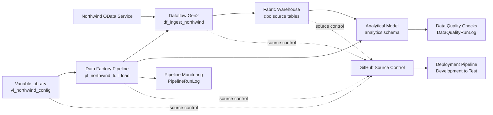

# Fabric Northwind Orchestration

Metadata-driven ingestion, orchestration, analytical modeling, data quality, monitoring, and CI/CD solution built with Microsoft Fabric.

## Project Overview

Fabric Northwind Orchestration demonstrates how to build and operate a controlled batch data pipeline in Microsoft Fabric.

The solution ingests eight Northwind source tables from a public OData service, loads the data into a Fabric Warehouse, rebuilds a curated dimensional model, executes measurable data quality checks, records pipeline execution history, and supports controlled deployment between Development and Test environments.

The project was built entirely with Microsoft Fabric Trial resources. It does not require an Azure subscription, external paid services, or paid data sources.

## Business Scenario

A company needs a repeatable and observable process for loading operational sales data into an analytical warehouse.

The solution must:

- ingest customer, order, product, employee, supplier, category, and shipping data;
- prevent duplicate records during repeated full loads;
- build a curated dimensional model;
- validate data after every analytical model refresh;
- record successful and failed pipeline executions;
- support environment-specific configuration;
- run automatically on a defined schedule;
- maintain supported Fabric item definitions in GitHub;
- deploy consistently from Development to Test.

## Architecture



## Microsoft Fabric Components

| Component | Name | Purpose |
|---|---|---|
| Dataflow Gen2 | `df_ingest_northwind` | Ingests and prepares Northwind OData tables |
| Warehouse | `NorthwindWarehouse` | Stores source data, analytical tables, stored procedures, and execution logs |
| Data Factory Pipeline | `pl_northwind_full_load` | Orchestrates the complete full-load process |
| Variable Library | `vl_northwind_config` | Stores environment-specific configuration |
| Task Flow | `Northwind Orchestration Flow` | Documents logical dependencies between workspace items |
| Deployment Pipeline | `Northwind Orchestration Deployment` | Deploys the solution from Development to Test |
| GitHub repository | `fabric-northwind-orchestration` | Stores version-controlled Microsoft Fabric item definitions and project documentation |

## Source Data

The project uses the public Northwind OData service:

https://services.odata.org/v4/northwind/northwind.svc/

The following base tables are ingested:

- `Categories`
- `Customers`
- `Employees`
- `Order_Details`
- `Orders`
- `Products`
- `Shippers`
- `Suppliers`

OData navigation columns and unnecessary binary columns are removed before loading.

## Orchestration Flow

The main pipeline executes the following success path:

```text
Prepare Northwind Full Load
→ Load Northwind Data
→ Refresh Analytical Model
→ Validate Data Quality
→ Log Pipeline Success
```

### Failure handling

Two independent failure branches are implemented.

Dataflow failure:

```text
Load Northwind Data
→ Log Pipeline Failure
→ Terminate Pipeline as Failed
```

Analytical model refresh failure:

```text
Refresh Analytical Model
→ Log Analytical Model Failure
→ Terminate Model Refresh as Failed
```

The pipeline records error details before explicitly terminating the execution with a failed status.

## Full-Load Strategy

Dataflow Gen2 uses the `Append` update method.

Before loading data, the pipeline executes:

```text
dbo.usp_prepare_northwind_full_load
```

The procedure truncates all eight source tables before Dataflow Gen2 reloads the complete Northwind dataset.

This truncate-and-reload pattern makes repeated full loads idempotent at the table-content level and prevents duplicate accumulation between successful executions.

## Warehouse Design

### Source schema

The `dbo` schema stores the ingested Northwind tables:

```text
dbo.Categories
dbo.Customers
dbo.Employees
dbo.Order_Details
dbo.Orders
dbo.Products
dbo.Shippers
dbo.Suppliers
```

### Analytical schema

The `analytics` schema separates curated analytical objects from source ingestion tables.

Dimensions:

```text
analytics.DimCategory
analytics.DimCustomer
analytics.DimEmployee
analytics.DimProduct
analytics.DimShipper
analytics.DimSupplier
```

Fact table:

```text
analytics.FactSales
```

The grain of `analytics.FactSales` is one order-product line.

### Analytical measures stored in the fact table

- quantity;
- unit price;
- discount rate;
- gross sales amount;
- net sales amount;
- order freight.

The available source dataset does not contain usable order dates. The project therefore intentionally avoids creating an artificial date dimension that would imply unsupported temporal analysis.

## Stored Procedures

| Procedure | Purpose |
|---|---|
| `dbo.usp_prepare_northwind_full_load` | Truncates source tables before each full load |
| `analytics.usp_refresh_analytical_model` | Rebuilds dimensions and the sales fact table |
| `dbo.usp_validate_northwind_data_quality` | Executes and records measurable data quality checks |
| `dbo.usp_log_northwind_pipeline_success` | Records successful pipeline executions |
| `dbo.usp_log_northwind_pipeline_failure` | Records failed pipeline executions and error details |

## Data Quality Framework

Data quality results are stored in:

```text
dbo.DataQualityRunLog
```

Each pipeline execution validates seven expected analytical row counts:

| Check | Expected value |
|---|---:|
| `DimCategory row count` | 8 |
| `DimCustomer row count` | 91 |
| `DimEmployee row count` | 9 |
| `DimProduct row count` | 77 |
| `DimShipper row count` | 3 |
| `DimSupplier row count` | 29 |
| `FactSales row count` | 2,155 |

If any check fails:

1. the failed result is written to `DataQualityRunLog`;
2. the validation procedure raises a T-SQL exception;
3. the pipeline follows its failure path;
4. error details are written to `PipelineRunLog`;
5. the complete pipeline execution is marked as failed.

## Pipeline Monitoring

Pipeline execution history is stored in:

```text
dbo.PipelineRunLog
```

Recorded fields include:

- pipeline run identifier;
- pipeline name;
- environment name;
- start time;
- end time;
- execution status;
- error message;
- log timestamp.

The monitoring table supplements native Microsoft Fabric run history with queryable operational metadata stored in the Warehouse.

## Environment Configuration

The Variable Library contains:

```text
vl_northwind_config.environment_name
```

Configured value sets:

| Value set | Value | Usage |
|---|---|---|
| Default | `Development` | Development workspace |
| Test | `Test` | Test workspace |
| Production | `Production` | Reserved for a future production deployment |

The active value set is selected independently in each environment.

The pipeline resolves the environment dynamically through:

```text
@pipeline().libraryVariables.vl_northwind_config_environment_name
```

## Development and Test Environments

### Development

Workspace:

```text
Fabric Northwind Orchestration
```

Active environment value:

```text
Development
```

### Test

Workspace:

```text
Fabric Northwind Orchestration Test
```

Active environment value:

```text
Test
```

Deployment to Test was completed through the Fabric Deployment Pipeline.

Dataflow Gen2 Warehouse destinations and stored-procedure activity connections were remapped to the Test Warehouse after deployment.

The Test pipeline completed successfully, including source preparation, ingestion, analytical model refresh, data quality validation, and success logging.

A Production stage is included in the deployment design but was intentionally not provisioned to avoid unnecessary Microsoft Fabric Trial capacity consumption.

## Scheduling

The Development pipeline is scheduled to run:

```text
Daily at 06:00 AM
Time zone: Warsaw, UTC+01:00
```

Failure notifications are configured for the project account.

The fixed UTC offset documents the configuration visible during validation. Daylight-saving changes may require schedule verification in Microsoft Fabric.

## Task Flow

The workspace Task Flow documents the logical project structure:

```text
Develop → General → Get data → Store
```

Assigned workspace items:

```text
vl_northwind_config
→ pl_northwind_full_load
→ df_ingest_northwind
→ NorthwindWarehouse
```

Task Flow connectors document logical dependencies and do not execute physical data movement.

## Validation Results

### Source tables

| Source table | Records |
|---|---:|
| Categories | 8 |
| Customers | 91 |
| Employees | 9 |
| Order_Details | 2,155 |
| Orders | 830 |
| Products | 77 |
| Shippers | 3 |
| Suppliers | 29 |

### Analytical tables

| Analytical table | Records |
|---|---:|
| DimCategory | 8 |
| DimCustomer | 91 |
| DimEmployee | 9 |
| DimProduct | 77 |
| DimShipper | 3 |
| DimSupplier | 29 |
| FactSales | 2,155 |

Development and Test pipeline executions completed successfully.

All seven analytical data quality checks were recorded as `Passed`.

The validated `FactSales` row count matches the source `Order_Details` row count of 2,155, which is consistent with the declared grain of one order-product line.

## CI/CD

The project uses two complementary lifecycle-management mechanisms.

### GitHub integration

The following Microsoft Fabric item definitions are versioned in this repository:

```text
df_ingest_northwind
NorthwindWarehouse
pl_northwind_full_load
vl_northwind_config
```

### Deployment Pipeline

The Fabric Deployment Pipeline contains:

```text
Development
Test
Production
```

Development and Test are provisioned and validated.

Production remains intentionally unassigned.

Environment-specific Warehouse destinations and stored-procedure connections must be verified and, where required, remapped after deployment.

## Security and Operational Practices

- Anonymous authentication is used only for the public Northwind OData demonstration endpoint.
- No credentials, access tokens, or private connection strings are stored in the repository.
- GitHub access uses a fine-grained token restricted to this repository.
- Environment configuration is centralized in Fabric Variable Library.
- Failure branches record error information before explicitly terminating the pipeline.
- Development and Test use separate Warehouse items and environment values.
- Warehouse targets are verified before deployed pipelines are executed.
- Production is intentionally not provisioned.
- Trial capacity consumption is limited through one daily schedule and a lightweight demonstration dataset.

## Reproduction Guide

### Prerequisites

- access to a Microsoft Fabric workspace with the required capacity;
- permission to create a Warehouse, Dataflow Gen2, Data Factory Pipeline, and Variable Library;
- access to Fabric Git integration;
- access to Fabric Deployment Pipelines;
- access to the public Northwind OData endpoint;
- appropriate workspace and deployment permissions.

### Recommended deployment order

1. Connect the Development workspace to the GitHub repository.
2. Synchronize the supported Microsoft Fabric item definitions.
3. Verify the `NorthwindWarehouse` item.
4. Verify Dataflow Gen2 destinations for all eight source tables.
5. Verify stored-procedure activity connections in `pl_northwind_full_load`.
6. Configure the active Variable Library value set.
7. Confirm access to the public Northwind OData endpoint.
8. Execute the pipeline manually.
9. Verify source and analytical row counts.
10. Confirm that all seven data quality checks passed.
11. Confirm the successful entry in `PipelineRunLog`.
12. Configure scheduling and failure notifications.
13. Deploy the solution to Test through the Fabric Deployment Pipeline.
14. Remap Test Warehouse destinations and stored-procedure connections.
15. Execute and validate the Test pipeline.

Do not store credentials, tokens, or private connection information in repository files.

## Known Limitations

- The project uses a full-load strategy rather than incremental CDC.
- Northwind is a static demonstration dataset.
- Expected source row counts are specific to the public Northwind sample.
- Dataflow Gen2 CI/CD support includes Preview capabilities.
- Warehouse destinations require verification or remapping after Dataflow deployment.
- Some stored-procedure activity connections require remapping after deployment.
- The Production stage is not provisioned.
- Microsoft Fabric Trial resources expire unless the workspaces are reassigned to an eligible capacity.
- The source does not provide suitable date fields for a meaningful date dimension.
- The solution validates expected row counts but does not implement a complete enterprise reconciliation framework.
- No Power BI report is included because the project focuses on Data Factory orchestration, Warehouse engineering, automated data quality, monitoring, and CI/CD.

## Repository Structure

```text
fabric-northwind-orchestration/
├── NorthwindWarehouse.Warehouse/
│   └── Microsoft Fabric Warehouse item definition
├── df_ingest_northwind.Dataflow/
│   └── Dataflow Gen2 item definition
├── pl_northwind_full_load.DataPipeline/
│   └── Data Factory Pipeline item definition
├── vl_northwind_config.VariableLibrary/
│   └── Variable Library item definition
├── deployment-pipeline.png
│   └── Development-to-Test deployment evidence
├── workspace-overview.png
│   └── Development workspace and Task Flow evidence
├── LICENSE
│   └── MIT License
└── README.md
    └── Architecture, deployment, validation, security, and reproduction documentation
```

The four Microsoft Fabric item folders are synchronized from the Development workspace through Fabric Git integration.

The repository also contains an MIT License and visual evidence of the Development workspace, Task Flow, and Development-to-Test deployment.

Versioned portfolio milestones are published separately through GitHub Releases.

## Key Skills Demonstrated

- Microsoft Fabric Data Factory
- Dataflow Gen2
- Power Query Online
- Microsoft Fabric Warehouse
- Data Factory Pipelines
- T-SQL stored procedures
- dimensional modeling
- metadata-driven configuration
- Fabric Variable Library
- automated data quality controls
- pipeline monitoring
- failure handling
- scheduling and notifications
- Fabric Task Flow
- GitHub source control
- Fabric Deployment Pipelines
- Development and Test environment management
- CI/CD connection remapping
- technical documentation and reproducibility

## Project Screenshots

### Workspace and Task Flow

The Development workspace contains the synchronized Dataflow Gen2, Warehouse, Pipeline, and Variable Library items.

The Task Flow documents the logical dependency chain from environment configuration through orchestration and ingestion to storage.


### Deployment Pipeline

The Deployment Pipeline promotes the solution from Development to Test.

All four deployed Fabric items are paired and validated. Production is intentionally not provisioned to conserve Microsoft Fabric Trial capacity.


## Release

The first validated portfolio version is published as:

```text
v1.0.0
```

The release documents the completed ingestion, Warehouse model, orchestration, data quality controls, monitoring, environment configuration, and Development-to-Test deployment.

## License

This project is licensed under the LICENSE.

## Project Status

```text
Technical implementation: Complete
Development validation: Passed
Test deployment: Passed
Test pipeline execution: Passed
Test data quality checks: 7 of 7 Passed
GitHub synchronization: Complete
Documentation: Complete
GitHub Release: v1.0.0
Production deployment: Intentionally not provisioned
```

## Author

**Kamil Soszka**

Microsoft Fabric data engineering portfolio project.
