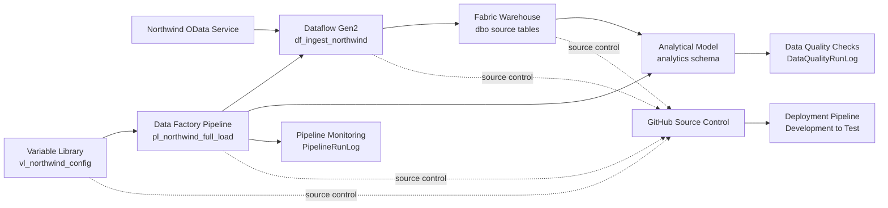

# Fabric Northwind Orchestration

Metadata-driven ingestion, orchestration, analytical modeling, data quality, monitoring, and CI/CD solution built with Microsoft Fabric.

## Project Overview

Fabric Northwind Orchestration demonstrates how to build and operate a controlled batch data pipeline in Microsoft Fabric.

The solution ingests Northwind data from a public OData service, loads eight source tables into a Fabric Warehouse, rebuilds a curated dimensional model, executes measurable data quality checks, records pipeline execution history, and supports deployment between Development and Test environments.

The project was built entirely with Microsoft Fabric Trial resources. It does not require an Azure subscription, external paid services, or paid data sources.

## Business Scenario

A company needs a repeatable process for loading operational sales data into an analytical warehouse.

The process must:

- ingest customer, order, product, employee, supplier, category, and shipping data;
- prevent duplicate records during repeated full loads;
- build a curated analytical model;
- validate data after every refresh;
- record successful and failed executions;
- support environment-specific configuration;
- run automatically on a schedule;
- maintain source control in GitHub;
- deploy consistently from Development to Test.

## Architecture



## Microsoft Fabric Components

| Component | Name | Purpose |
|---|---|---|
| Dataflow Gen2 | `df_ingest_northwind` | Ingests and prepares Northwind OData tables |
| Warehouse | `NorthwindWarehouse` | Stores source data, analytical tables, procedures, and execution logs |
| Data Factory Pipeline | `pl_northwind_full_load` | Orchestrates the complete full-load process |
| Variable Library | `vl_northwind_config` | Stores environment-specific configuration |
| Task Flow | `Northwind Orchestration Flow` | Documents logical dependencies between workspace items |
| Deployment Pipeline | `Northwind Orchestration Deployment` | Deploys the solution from Development to Test |
| GitHub repository | `fabric-northwind-orchestration` | Stores versioned Microsoft Fabric item definitions |

## Source Data

The project uses the public Northwind OData service:

```text
https://services.odata.org/v4/northwind/northwind.svc/
```

The following base tables are ingested:

- `Categories`
- `Customers`
- `Employees`
- `Order_Details`
- `Orders`
- `Products`
- `Shippers`
- `Suppliers`

OData navigation columns and unnecessary binary columns are removed before loading.

## Orchestration Flow

The main pipeline executes the following success path:

```text
Prepare Northwind Full Load
→ Load Northwind Data
→ Refresh Analytical Model
→ Validate Data Quality
→ Log Pipeline Success
```

### Failure handling

Two independent failure branches are implemented.

Dataflow failure:

```text
Load Northwind Data
→ Log Pipeline Failure
→ Terminate Pipeline as Failed
```

Analytical model refresh failure:

```text
Refresh Analytical Model
→ Log Analytical Model Failure
→ Terminate Model Refresh as Failed
```

The pipeline records error details before explicitly terminating the execution with a failed status.

## Full-Load Strategy

Dataflow Gen2 uses the `Append` update method.

To prevent duplicate data, the pipeline first executes:

```text
dbo.usp_prepare_northwind_full_load
```

The procedure truncates all eight source tables before Dataflow Gen2 reloads the complete Northwind dataset.

Repeated pipeline runs therefore produce stable row counts instead of duplicated records.

## Warehouse Design

### Source schema

The `dbo` schema stores the ingested Northwind tables:

```text
dbo.Categories
dbo.Customers
dbo.Employees
dbo.Order_Details
dbo.Orders
dbo.Products
dbo.Shippers
dbo.Suppliers
```

### Analytical schema

The `analytics` schema separates curated analytical objects from source ingestion tables.

Dimensions:

```text
analytics.DimCategory
analytics.DimCustomer
analytics.DimEmployee
analytics.DimProduct
analytics.DimShipper
analytics.DimSupplier
```

Fact table:

```text
analytics.FactSales
```

The grain of `FactSales` is one order-product line.

### Analytical measures stored in the fact table

- quantity;
- unit price;
- discount rate;
- gross sales amount;
- net sales amount;
- order freight.

The source dataset does not contain usable order dates, so the project intentionally does not create an artificial date dimension.

## Stored Procedures

| Procedure | Purpose |
|---|---|
| `dbo.usp_prepare_northwind_full_load` | Truncates source tables before each full load |
| `analytics.usp_refresh_analytical_model` | Rebuilds dimensions and the sales fact table |
| `dbo.usp_validate_northwind_data_quality` | Executes and records measurable quality checks |
| `dbo.usp_log_northwind_pipeline_success` | Records successful pipeline executions |
| `dbo.usp_log_northwind_pipeline_failure` | Records failed pipeline executions and error details |

## Data Quality Framework

Quality results are stored in:

```text
dbo.DataQualityRunLog
```

Each pipeline execution validates seven expected row counts:

| Check | Expected value |
|---|---:|
| `DimCategory row count` | 8 |
| `DimCustomer row count` | 91 |
| `DimEmployee row count` | 9 |
| `DimProduct row count` | 77 |
| `DimShipper row count` | 3 |
| `DimSupplier row count` | 29 |
| `FactSales row count` | 2,155 |

If any check fails:

1. the failed result is written to `DataQualityRunLog`;
2. the validation procedure raises a T-SQL exception;
3. the Pipeline follows its failure path;
4. error details are written to `PipelineRunLog`;
5. the complete Pipeline run is marked as failed.

## Pipeline Monitoring

Execution history is stored in:

```text
dbo.PipelineRunLog
```

Recorded fields include:

- Pipeline run identifier;
- Pipeline name;
- environment name;
- start time;
- end time;
- execution status;
- error message;
- log timestamp.

This monitoring table supplements the native Microsoft Fabric run history with queryable operational metadata.

## Environment Configuration

The Variable Library contains:

```text
vl_northwind_config.environment_name
```

Configured value sets:

| Value set | Value | Usage |
|---|---|---|
| Default | `Development` | Development workspace |
| Test | `Test` | Test workspace |
| Production | `Production` | Reserved for a future production deployment |

The active value set is selected independently in each environment.

The Pipeline reads the environment dynamically through:

```text
@pipeline().libraryVariables.vl_northwind_config_environment_name
```

## Development and Test Environments

### Development

Workspace:

```text
Fabric Northwind Orchestration
```

Active environment value:

```text
Development
```

### Test

Workspace:

```text
Fabric Northwind Orchestration Test
```

Active environment value:

```text
Test
```

Deployment to Test was completed through the Fabric Deployment Pipeline.

Dataflow Gen2 Warehouse destinations and stored-procedure activity connections were remapped to the Test Warehouse after deployment.

A Production stage is included in the deployment design but was not provisioned to avoid unnecessary Trial capacity use.

## Scheduling

The Development Pipeline is scheduled to run:

```text
Daily at 06:00 AM
Time zone: Warsaw, UTC+01:00
```

Failure notifications are configured for the project account.

## Task Flow

The workspace Task Flow documents the logical project structure:

```text
Develop → General → Get data → Store
```

Assigned workspace items:

```text
vl_northwind_config
→ pl_northwind_full_load
→ df_ingest_northwind
→ NorthwindWarehouse
```

Task Flow connectors document logical dependencies and do not execute physical data movement.

## Validation Results

Validated source row counts:

| Source table | Records |
|---|---:|
| Categories | 8 |
| Customers | 91 |
| Employees | 9 |
| Order_Details | 2,155 |
| Orders | 830 |
| Products | 77 |
| Shippers | 3 |
| Suppliers | 29 |

Validated analytical row counts:

| Analytical table | Records |
|---|---:|
| DimCategory | 8 |
| DimCustomer | 91 |
| DimEmployee | 9 |
| DimProduct | 77 |
| DimShipper | 3 |
| DimSupplier | 29 |
| FactSales | 2,155 |

Development and Test pipeline executions completed successfully with all seven data quality checks marked as `Passed`.

## CI/CD

The project uses two complementary lifecycle-management mechanisms.

### GitHub integration

Microsoft Fabric item definitions are versioned in this repository:

```text
df_ingest_northwind
NorthwindWarehouse
pl_northwind_full_load
vl_northwind_config
```

### Deployment Pipeline

The Fabric Deployment Pipeline contains:

```text
Development
Test
Production
```

Development and Test are provisioned and validated. Production remains intentionally unassigned.

## Security and Operational Practices

- Anonymous authentication is used only for the public Northwind OData demonstration endpoint.
- No credentials or access tokens are stored in the repository.
- GitHub access uses a fine-grained token restricted to this repository.
- Environment configuration is centralized in Variable Library.
- Failure branches record errors before terminating the Pipeline.
- Test and Development use separate Warehouse items and environment values.
- Warehouse targets are verified before executing deployed pipelines.
- Trial capacity consumption is limited by using one daily schedule and lightweight sample data.

## Known Limitations

- The project uses a full-load strategy rather than incremental CDC.
- Northwind is a static demonstration dataset.
- Source row-count expectations are specific to the public Northwind sample.
- Dataflow Gen2 CI/CD support is marked as Preview.
- Warehouse destinations require environment remapping after Dataflow deployment.
- Some stored-procedure activity connections require remapping after deployment.
- The Production stage is not provisioned.
- The Fabric Trial expires unless the workspaces are reassigned to a paid capacity.
- The source does not provide suitable date fields for a meaningful date dimension.
- No Power BI report is included because the portfolio goal is Data Factory orchestration, Warehouse engineering, quality controls, and CI/CD.

## Repository Structure

The Fabric-generated folders contain item definitions synchronized from the Development workspace.

The repository also contains project documentation and will include release information and portfolio screenshots.

## Key Skills Demonstrated

- Microsoft Fabric Data Factory
- Dataflow Gen2
- Power Query Online
- Microsoft Fabric Warehouse
- Data Factory Pipelines
- T-SQL stored procedures
- dimensional modeling
- metadata and environment configuration
- Variable Library
- automated data quality controls
- pipeline monitoring and error handling
- scheduling and notifications
- Fabric Task Flow
- GitHub source control
- Fabric Deployment Pipelines
- Development and Test environment management

## Project Status

```text
Technical implementation: Complete
Development validation: Passed
Test deployment: Passed
Test data quality checks: Passed
GitHub synchronization: Complete
Production deployment: Not provisioned
```

## Author

**Kamil Soszka**

Microsoft Fabric data engineering portfolio project.
