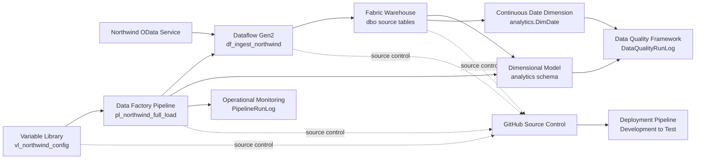
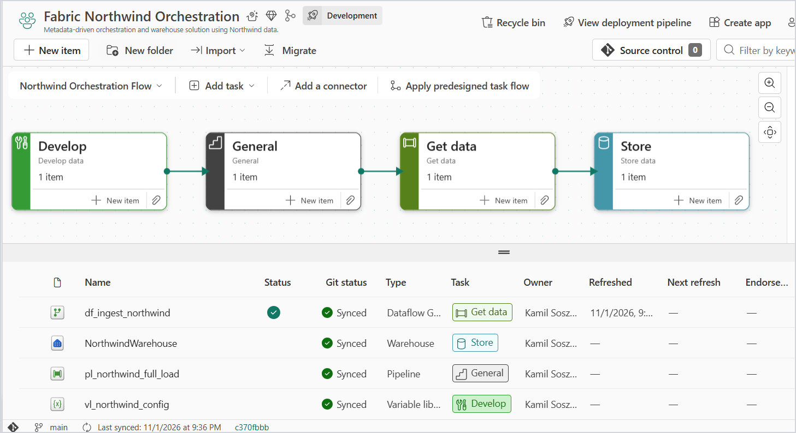
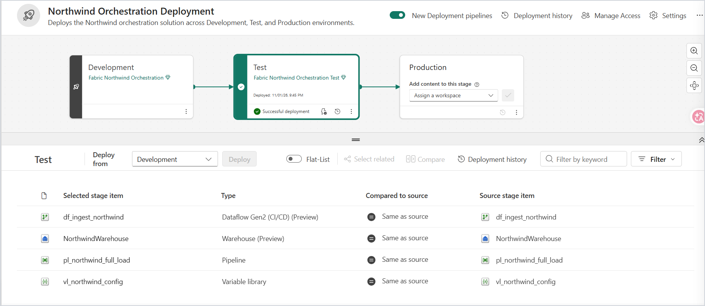

# Fabric Northwind Orchestration

Metadata-driven ingestion, orchestration, dimensional modeling, automated data quality, operational monitoring, and controlled Development-to-Test deployment built with Microsoft Fabric.

## Project Overview

Fabric Northwind Orchestration demonstrates how to build, operate, monitor, version, and deploy a controlled batch data pipeline in Microsoft Fabric.

The solution:

- ingests eight Northwind source tables from a public OData service;
- loads the source data into Microsoft Fabric Warehouse;
- rebuilds a curated dimensional model;
- generates a continuous date dimension;
- validates dimensional relationships and business rules;
- reconciles source and analytical data;
- records successful and failed pipeline executions;
- supports environment-specific configuration;
- versions supported Fabric items in GitHub;
- deploys controlled changes from Development to Test.

The project was built with Microsoft Fabric Trial resources. It does not require an Azure subscription, paid external services, or paid data sources.

## Business Scenario

A company needs a repeatable and observable process for loading operational sales data into an analytical warehouse.

The process must:

- ingest customer, order, product, employee, supplier, category, shipping, and order-line data;
- prevent duplicate accumulation during repeated full loads;
- rebuild a dimensional analytical model;
- preserve a clearly defined fact-table grain;
- generate a continuous calendar from available source dates;
- validate data after every analytical model refresh;
- reconcile source and analytical values;
- record successful and failed pipeline executions;
- support environment-specific configuration;
- run automatically on a defined schedule;
- maintain supported Microsoft Fabric item definitions in GitHub;
- deploy controlled changes from Development to Test.

## Architecture



## Microsoft Fabric Components

| Component | Name | Purpose |
|---|---|---|
| Dataflow Gen2 | `df_ingest_northwind` | Ingests and prepares eight Northwind OData tables |
| Warehouse | `NorthwindWarehouse` | Stores source data, dimensional tables, stored procedures, quality results, and pipeline logs |
| Data Factory Pipeline | `pl_northwind_full_load` | Orchestrates the complete full-load process |
| Variable Library | `vl_northwind_config` | Stores environment-specific configuration |
| Task Flow | `Northwind Orchestration Flow` | Documents logical dependencies between Development workspace items |
| Deployment Pipeline | `Northwind Orchestration Deployment` | Promotes selected changes from Development to Test |
| GitHub repository | `fabric-northwind-orchestration` | Stores version-controlled Fabric item definitions and documentation |

## Source Data

The project uses the public Northwind OData service:

```text
https://services.odata.org/v4/northwind/northwind.svc/
```

The following tables are ingested:

- `Categories`
- `Customers`
- `Employees`
- `Order_Details`
- `Orders`
- `Products`
- `Shippers`
- `Suppliers`

OData navigation columns and unnecessary binary columns are removed before loading.

## Orchestration Flow

The pipeline executes the following success path:

```text
Prepare Northwind Full Load
→ Load Northwind Data
→ Refresh Analytical Model
→ Validate Data Quality
→ Log Pipeline Success
```

### Failure handling

The pipeline implements explicit failure handling for ingestion and analytical-model refresh failures.

Dataflow failure path:

```text
Load Northwind Data
→ Log Pipeline Failure
→ Terminate Pipeline as Failed
```

Analytical-model refresh failure path:

```text
Refresh Analytical Model
→ Log Analytical Model Failure
→ Terminate Model Refresh as Failed
```

Error information is recorded before the pipeline explicitly terminates with a failed status.

## Full-Load Strategy

Dataflow Gen2 uses the `Append` update method.

Before Dataflow Gen2 starts, the pipeline executes:

```text
dbo.usp_prepare_northwind_full_load
```

The procedure truncates all eight source tables:

```text
dbo.Order_Details
dbo.Orders
dbo.Products
dbo.Categories
dbo.Customers
dbo.Employees
dbo.Shippers
dbo.Suppliers
```

The procedure is executed before ingestion. Repeated successful pipeline runs therefore rebuild the source layer with stable row counts and do not accumulate duplicates.

### Full-load recovery limitation

The active source tables are truncated before the external Dataflow Gen2 load starts.

If ingestion fails after the truncate operation, the source layer may remain empty or partially loaded until the next successful full pipeline execution.

A production-grade implementation should instead:

1. load data into separate staging tables;
2. validate source completeness;
3. promote the validated dataset to the active source layer through a controlled swap or equivalent atomic process.

## Warehouse Design

The project uses two principal Warehouse schemas.

### Source layer

The `dbo` schema stores the ingested operational tables:

```text
dbo.Categories
dbo.Customers
dbo.Employees
dbo.Order_Details
dbo.Orders
dbo.Products
dbo.Shippers
dbo.Suppliers
```

### Analytical layer

The `analytics` schema stores the dimensional model.

Dimensions:

```text
analytics.DimCategory
analytics.DimCustomer
analytics.DimDate
analytics.DimEmployee
analytics.DimProduct
analytics.DimShipper
analytics.DimSupplier
```

Fact table:

```text
analytics.FactSales
```

The project does not use formal Bronze, Silver, and Gold schemas. The `dbo` and `analytics` separation is intentional and appropriate for this Warehouse-focused orchestration solution.

## Dimensional Model

### FactSales grain

The grain of `analytics.FactSales` is:

```text
One order-product line
```

The unique grain is represented by:

```text
OrderKey + ProductKey
```

The validated source and fact row counts are both `2,155`.

### Date dimension

`analytics.DimDate` is generated as a continuous calendar from the minimum and maximum source dates found in:

- `Orders.OrderDate`
- `Orders.RequiredDate`
- `Orders.ShippedDate`

Validated date range:

```text
1996-07-04 to 1998-06-11
```

Validated number of calendar rows:

```text
708
```

`FactSales` contains three date roles:

- `OrderDateKey`
- `RequiredDateKey`
- `ShippedDateKey`

`OrderDateKey` and `RequiredDateKey` are required. `ShippedDateKey` may be null for orders that have not been shipped.

### Product relationships

`analytics.DimProduct` references:

- `analytics.DimCategory` through `CategoryKey`;
- `analytics.DimSupplier` through `SupplierKey`.

Both relationships were validated with zero missing references.

### Sales measures

`analytics.FactSales` stores:

- quantity;
- unit price;
- discount rate;
- gross sales amount;
- net sales amount;
- order freight.

Gross sales are calculated as:

```text
Quantity × UnitPrice
```

Net sales are calculated as:

```text
Quantity × UnitPrice × (1 - DiscountRate)
```

### Order freight allocation

Source freight exists at the order grain, while `FactSales` uses the order-product-line grain.

To prevent repeated freight values from being summed once for every product line, the analytical refresh procedure stores order freight exactly once per order.

The freight value is assigned to the order line with the lowest `ProductID`. All remaining lines for the same order receive zero freight.

This deterministic allocation preserves an additive `SUM(OrderFreight)` while retaining the declared fact-table grain.

Validated freight reconciliation:

```text
Source freight: 64,942.69
FactSales freight: 64,942.69
Difference: 0.00
Orders with invalid freight allocation: 0
```

## Stored Procedures

| Procedure | Purpose |
|---|---|
| `dbo.usp_prepare_northwind_full_load` | Truncates the eight source tables before a full reload |
| `analytics.usp_refresh_analytical_model` | Rebuilds the continuous date dimension, analytical dimensions, and `FactSales` |
| `dbo.usp_validate_northwind_data_quality` | Executes and records measurable data-quality checks |
| `dbo.usp_log_northwind_pipeline_success` | Records successful pipeline executions |
| `dbo.usp_log_northwind_pipeline_failure` | Records failed pipeline executions and error details |

## Analytical Refresh Controls

`analytics.usp_refresh_analytical_model` executes the model refresh inside a database transaction.

The procedure:

- calculates the source date range;
- rejects an empty date range;
- calculates the expected source-to-fact row count dynamically;
- rebuilds the continuous date dimension;
- rebuilds all dimensions and the fact table;
- validates row counts;
- validates key uniqueness;
- validates the fact-table grain;
- validates dimensional relationships;
- validates date relationships;
- validates source date chronology;
- validates sales calculations;
- reconciles source and fact freight;
- validates order-level freight allocation;
- commits only after all controls succeed;
- rolls back the model refresh and rethrows the error when a control fails.

Expected Northwind dimension counts remain fixed because the project uses the public static Northwind demonstration dataset. Source-to-fact reconciliation and date-range validation are calculated dynamically.

## Data Quality Framework

Quality results are written to:

```text
dbo.DataQualityRunLog
```

The post-refresh validation procedure records 11 controls for each successful run:

| Check | Expected value |
|---|---:|
| `DimCategory row count` | 8 |
| `DimCustomer row count` | 91 |
| `DimDate row count` | 708 for the validated source snapshot |
| `DimEmployee row count` | 9 |
| `DimProduct row count` | 77 |
| `DimShipper row count` | 3 |
| `DimSupplier row count` | 29 |
| `FactSales row count` | 2,155 |
| `Missing required fact date keys` | 0 |
| `Invalid fact date relationships` | 0 |
| `Invalid source date chronology` | 0 |

The expected `DimDate` row count is calculated from the actual source date range during validation.

If any control fails:

1. the result is written to `DataQualityRunLog`;
2. the validation procedure raises a T-SQL exception;
3. the pipeline follows its failure path;
4. error details are written to `PipelineRunLog`;
5. the pipeline execution is marked as failed.

## Pipeline Monitoring

Pipeline history is stored in:

```text
dbo.PipelineRunLog
```

Recorded fields include:

- pipeline run identifier;
- pipeline name;
- environment name;
- start time;
- end time;
- execution status;
- error message;
- log timestamp.

The table supplements native Microsoft Fabric run history with queryable operational metadata.

Both successful and failed executions are retained. Historical failures are not removed because they provide evidence that failure handling and validation controls operated as designed.

## Environment Configuration

The Variable Library contains:

```text
vl_northwind_config.environment_name
```

Configured value sets:

| Value set | Value | Usage |
|---|---|---|
| Default | `Development` | Development workspace |
| Test | `Test` | Test workspace |

The active value set is selected independently in each environment.

The pipeline resolves the value dynamically:

```text
@pipeline().libraryVariables.vl_northwind_config_environment_name
```

A Production value set is not currently implemented.

## Environments

### Development

Workspace:

```text
Fabric Northwind Orchestration
```

Active environment value:

```text
Development
```

### Test

Workspace:

```text
Fabric Northwind Orchestration Test
```

Active environment value:

```text
Test
```

The current Deployment Pipeline contains two provisioned stages:

```text
Development → Test
```

A Production stage and Production workspace are not currently implemented.

## Development-to-Test Deployment

The project uses the Fabric Deployment Pipeline named:

```text
Northwind Orchestration Deployment
```

The hardened Warehouse version was:

1. committed to GitHub;
2. synchronized to the Development workspace;
3. validated through a complete Development pipeline run;
4. selectively deployed as `NorthwindWarehouse` to Test;
5. validated through a complete Test pipeline run.

### Warehouse schema compatibility

Warehouse deployment uses preview deployment functionality and schema comparison.

During hardening, Deployment Pipeline detected schema drift in `analytics.DimDate`. The initial deployment failed because Fabric Warehouse could not perform several generated `ALTER COLUMN` operations that required data validation or rewriting.

The Test `DimDate` table was therefore rebuilt through a controlled migration that:

- preserved all 708 rows;
- preserved the date range from `1996-07-04` to `1998-06-11`;
- aligned column types, lengths, and nullability with Development;
- validated `DateKey` uniqueness;
- validated `IsWeekend`;
- removed the temporary backup table after a successful migration.

After schema alignment, the selective Warehouse deployment completed successfully.

## Scheduling

The Development pipeline is configured to run:

```text
Daily at 06:00 AM
Time zone: Warsaw
```

Failure notifications are configured for the project account.

The displayed UTC offset depends on the active local time configuration. Scheduling should be verified after daylight-saving-time changes.

## Task Flow

The Development workspace Task Flow documents the logical structure:

```text
Develop → General → Get data → Store
```

Assigned items:

```text
vl_northwind_config
→ pl_northwind_full_load
→ df_ingest_northwind
→ NorthwindWarehouse
```

Task Flow connectors document logical dependencies. They do not execute physical data movement.

## Validated Results

### Source tables

| Source table | Records | Null keys | Duplicate keys |
|---|---:|---:|---:|
| Categories | 8 | 0 | 0 |
| Customers | 91 | 0 | 0 |
| Employees | 9 | 0 | 0 |
| Order_Details | 2,155 | 0 | 0 |
| Orders | 830 | 0 | 0 |
| Products | 77 | 0 | 0 |
| Shippers | 3 | 0 | 0 |
| Suppliers | 29 | 0 | 0 |

The `Order_Details` duplicate test uses the composite key:

```text
OrderID + ProductID
```

### Analytical tables

| Analytical table | Records |
|---|---:|
| DimCategory | 8 |
| DimCustomer | 91 |
| DimDate | 708 |
| DimEmployee | 9 |
| DimProduct | 77 |
| DimShipper | 3 |
| DimSupplier | 29 |
| FactSales | 2,155 |

### Business values

| Metric | Validated value |
|---|---:|
| Distinct orders | 830 |
| Distinct products in FactSales | 77 |
| FactSales grain rows | 2,155 |
| Total gross sales | 1,354,458.59 |
| Total net sales | 1,265,792.93 |
| Total quantity | 51,317 |
| Source freight | 64,942.69 |
| FactSales freight | 64,942.69 |
| Freight difference | 0.00 |
| Orders with invalid freight allocation | 0 |

### Date validation

| Metric | Validated value |
|---|---|
| Minimum date | 1996-07-04 |
| Maximum date | 1998-06-11 |
| Continuous date rows | 708 |
| Expected continuous date rows | 708 |
| Weekend rows | 202 |

## Validated Test Execution

The final Test pipeline execution completed successfully.

Pipeline run identifier:

```text
1454a84c-6893-4f34-8ce3-5c7e65f4af73
```

The following activities succeeded:

```text
Prepare Northwind Full Load
Load Northwind Data
Refresh Analytical Model
Validate Data Quality
Log Pipeline Success
```

The execution was recorded in `dbo.PipelineRunLog` with:

```text
RunStatus = Succeeded
EnvironmentName = Test
ErrorMessage = NULL
```

All 11 post-refresh quality checks were recorded as:

```text
Passed
```

## CI/CD

The project uses two complementary lifecycle-management mechanisms.

### GitHub integration

The following Microsoft Fabric item definitions are versioned:

```text
df_ingest_northwind
NorthwindWarehouse
pl_northwind_full_load
vl_northwind_config
```

The Warehouse is stored as a SQL project, including:

- schemas;
- tables;
- stored procedures;
- project configuration.

The hardened analytical refresh procedure was committed with:

```text
2c66f97
Fix freight allocation and strengthen warehouse validation
```

### Deployment Pipeline

The implemented deployment path is:

```text
Development → Test
```

Only reviewed items should be selected for deployment.

Dataflow Gen2 destinations, Warehouse procedure connections, Variable Library values, and other environment-specific settings must be verified before executing a deployed pipeline.

## Security and Operational Practices

- Anonymous authentication is used only for the public Northwind OData demonstration endpoint.
- No credentials, access tokens, or private connection strings are stored in the repository.
- GitHub access uses a repository-restricted authentication mechanism.
- Development and Test contain separate Warehouse items.
- Workspace access is limited to the project administrator.
- No unnecessary workspace users or groups were identified during validation.
- Environment configuration is centralized in Fabric Variable Library.
- Successful and failed executions are stored in operational log tables.
- Failure branches record error information before pipeline termination.
- Warehouse destinations and stored-procedure connections are verified before deployed pipelines are executed.
- Production is not currently provisioned.
- Trial capacity consumption is limited through a lightweight public dataset and a single daily Development schedule.

## Reproduction Guide

### Prerequisites

- access to Microsoft Fabric capacity;
- permission to create and manage a Warehouse;
- permission to create Dataflow Gen2 and Data Factory Pipeline items;
- permission to create a Variable Library;
- access to Fabric Git integration;
- access to Fabric Deployment Pipelines;
- access to the public Northwind OData endpoint;
- appropriate Development and Test workspace permissions.

### Recommended order

1. Create or assign the Development workspace.
2. Connect the Development workspace to this GitHub repository.
3. Synchronize the supported Microsoft Fabric item definitions.
4. Verify the `NorthwindWarehouse` SQL project.
5. Verify all eight Dataflow Gen2 Warehouse destinations.
6. Verify all stored-procedure activity connections in `pl_northwind_full_load`.
7. Confirm the Default Variable Library value set is active in Development.
8. Confirm access to the public Northwind OData endpoint.
9. Run the complete Development pipeline once.
10. Verify source row counts and source-key controls.
11. Verify dimensional row counts and relationships.
12. Verify the 11 post-refresh data-quality checks.
13. Verify the `PipelineRunLog` success entry.
14. Verify gross sales, net sales, quantity, and freight reconciliation.
15. Configure scheduling and failure notifications.
16. Create or assign the Test workspace.
17. Configure the Test Variable Library value set.
18. Compare Development and Test through the Deployment Pipeline.
19. Review selected Warehouse schema changes before deployment.
20. Deploy only the reviewed items.
21. Verify environment-specific Warehouse destinations and procedure connections.
22. Run the complete Test pipeline.
23. Verify the final Test monitoring and quality records.

Do not store credentials, tokens, tenant identifiers, private connection information, or diagnostic logs in the repository.

## Known Limitations

- The solution uses full-load ingestion rather than incremental CDC.
- Northwind is a static public demonstration dataset.
- Expected dimension counts are specific to the validated Northwind snapshot.
- The full-load procedure truncates active source tables before external ingestion.
- An ingestion failure after truncation can leave the source layer empty or partially loaded until the next successful execution.
- A production implementation should use staging tables and controlled data promotion.
- Dataflow Gen2 CI/CD capabilities include preview functionality.
- Warehouse deployment through Fabric Deployment Pipelines includes preview functionality.
- Some Warehouse column changes cannot be applied through generated `ALTER COLUMN` operations.
- Existing target schema drift may require a controlled migration before deployment.
- Dataflow destinations and stored-procedure connections require environment-specific verification.
- Production is not currently implemented.
- Microsoft Fabric Trial resources expire unless the workspaces are assigned to eligible capacity.
- Historical test failures remain in operational logs by design.
- The project uses recreated Type 1 dimensions and does not implement Slowly Changing Dimension Type 2 history.
- No Power BI report or Fabric App is included because the project focuses on ingestion, orchestration, Warehouse engineering, data quality, monitoring, and CI/CD.

## Repository Structure

```text
fabric-northwind-orchestration/
├── NorthwindWarehouse.Warehouse/
│   ├── analytics/
│   │   ├── StoredProcedures/
│   │   └── Tables/
│   ├── dbo/
│   │   ├── StoredProcedures/
│   │   └── Tables/
│   └── NorthwindWarehouse.sqlproj
├── df_ingest_northwind.Dataflow/
├── pl_northwind_full_load.DataPipeline/
├── vl_northwind_config.VariableLibrary/
├── deployment-pipeline.png
├── workspace-overview.png
├── LICENSE
└── README.md
```

The four supported Microsoft Fabric item folders are synchronized from the Development workspace through Fabric Git integration.

The repository also contains:

- an MIT License;
- Development workspace evidence;
- Task Flow evidence;
- Development-to-Test deployment evidence.

## Key Skills Demonstrated

- Microsoft Fabric Data Factory
- Dataflow Gen2
- Power Query Online
- Microsoft Fabric Warehouse
- Data Factory Pipelines
- T-SQL stored procedures
- transactional analytical refresh
- dimensional modeling
- continuous date-dimension generation
- fact-table grain control
- deterministic freight allocation
- source-to-fact reconciliation
- referential-integrity validation
- automated data-quality controls
- operational pipeline monitoring
- explicit failure handling
- scheduling and notifications
- Fabric Variable Library
- Fabric Task Flow
- GitHub source control
- SQL project versioning
- Fabric Deployment Pipelines
- Development and Test environment management
- schema-drift diagnosis and remediation
- technical documentation and reproducibility

## Project Screenshots

### Workspace and Task Flow

The Development workspace contains the synchronized Dataflow Gen2, Warehouse, Pipeline, and Variable Library items.

The Task Flow documents the logical dependency chain from environment configuration through orchestration and ingestion to storage.



### Deployment Pipeline

The Deployment Pipeline promotes reviewed changes from Development to Test.



## Release

The initial validated portfolio version was published as:

```text
v1.0.0
```

The hardened implementation introduces:

- a continuous date dimension;
- extended relationship and business-rule controls;
- source-to-fact reconciliation;
- deterministic order-freight allocation;
- freight reconciliation;
- validated Development-to-Test Warehouse deployment.

A new Semantic Versioning release should be created after the hardened repository state and final documentation are committed and verified.

## License

This project is licensed under the [MIT License](LICENSE).
